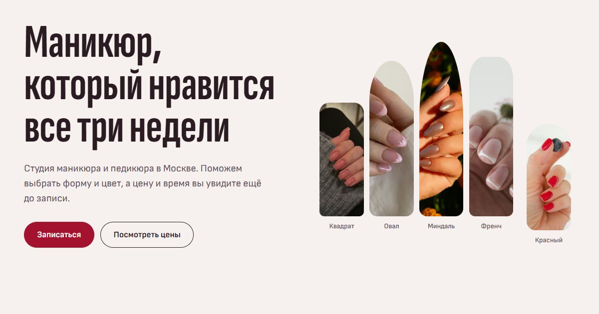

# «Лунка»: сайт маникюрной студии (демо для портфолио)

Сайт вымышленной студии маникюра и педикюра. Студии не существует, заявки никуда не отправляются, и сайт говорит об этом прямо.



## Что внутри

- **Первый экран-«рука».** Пять работ, каждая обрезана по форме ногтя (квадрат, овал, миндаль, френч, короткий круглый) и стоит на высоте своего пальца. При загрузке фото «прокрашиваются» снизу вверх, от кутикулы к краю, как ложится лак.
- **Услуги** простыми словами: что это, что входит, сколько стоит и сколько длится. Кнопка «Выбрать» подставляет услугу в форму записи.
- **Помощник «Не знаете, что выбрать?»**: два вопроса, ответ с услугой, доплатами, итогом и временем, кнопка «Записаться на это».
- **Галерея**: 24 работы в masonry, фильтр по категориям, лайтбокс на нативном `<dialog>` со стрелками, клавиатурой и свайпом.
- **Прайс** с отдельным списком доплат, которые обычно всплывают на кассе.
- **Визит и чистота**: что происходит за два часа, как обрабатываются инструменты.
- **Мастера**: вместо портретов показан «почерк», работа каждой.
- **Запись**: услуга, доплаты, мастер, день, время дня, имя, телефон, согласие. Сводка с ценой и длительностью обновляется на ходу. Есть ошибки у полей и общий список ошибок со ссылками. После отправки показывается экран «Заявка собрана» с честной пометкой, что ничего не отправлено.
- FAQ, контакты, страницы 404 и «Политика конфиденциальности».

## Запуск

```sh
npm install
npm run dev          # http://localhost:4321
npm run build        # astro check + статическая сборка в dist/
npm run preview      # собранный сайт с настоящей CSP, http://localhost:4321
npm test             # юнит-тесты, сборка, e2e (Playwright, Edge на Windows)
```

На других системах для e2e нужен `npx playwright install chromium`, либо канал браузера задаётся через `PW_CHANNEL`.

## Демо-данные: что заменить

| Что | Где |
|---|---|
| Название, адрес, часы, телефон, почта | `src/data/site.ts` |
| Услуги, цены, длительность, доплаты | `src/data/services.ts` |
| Логика помощника | `src/data/helper.ts` (покрыта `tests/unit/helper.test.ts`) |
| Мастера, отзывы, шаги визита, гигиена, FAQ | `src/data/content.ts` |
| Галерея и авторы фото | `src/data/photos.ts`, файлы в `src/assets/photos/` |
| Доплаты в форме и правила проверки | `src/lib/booking.ts` (покрыты `tests/unit/booking.test.ts`) |

Телефон `+7 (000) …` не выдан ни одному оператору, домен почты `.example` зарезервирован. Адрес вымышленный. Отзывы, мастера и цены придуманы и помечены на странице.

## Настоящие заявки

Сейчас форма ничего не отправляет: у вымышленной студии нет оператора данных, и собирать реальные телефоны посетителей портфолио было бы неправильно. Чтобы подключить запись:

1. В обработчике `submit` в `src/components/home/Booking.astro` есть отмеченное место. Там нужно отправить `POST` с полями формы на свой сервер или в сервис записи (YCLIENTS, Dikidi и подобные) через их API, либо в серверную функцию хостинга.
2. Секреты (токены API) держать только на сервере, не в клиентском коде.
3. Добавить адрес сервера в `connect-src` в `astro.config.mjs`.
4. Переписать текст экрана «Заявка собрана» и страницу `/privacy/`: указать оператора данных, срок хранения и способ отозвать согласие (152-ФЗ).

Микроразметку `BeautySalon` (schema.org) стоит добавить только для настоящего бизнеса: для вымышленного она стала бы ложными данными для поисковиков.

## Технологии

- Astro 7, статическая сборка, TypeScript strict, без UI-фреймворка.
- Anime.js 4.5: одна сцена загрузки первого экрана (слова заголовка, «прокрашивание» ногтей).
- Motion 14: реакции на действия (меню, шаги помощника, фильтр, лайтбокс, мобильная панель записи).
- Sofia Sans и Sofia Sans Extra Condensed с собственного хостинга (Fontsource), иконки Phosphor в SVG-спрайте.
- Строгий CSP в meta-теге, сторонних запросов нет. Единственный inline-скрипт (флаг `js`) разрешён по хешу.
- Фото в AVIF и WebP нужных размеров, ниже первого экрана грузятся лениво.

## Проверено

- `npm run build`: 0 ошибок типов.
- 11 юнит-тестов, 22 e2e (11 сценариев × десктоп и Pixel 7): SEO-основа, чистая консоль и CSP, нет горизонтальной прокрутки от 320 до 1440 px, axe WCAG 2.2 AA без серьёзных нарушений, якоря, помощник → форма, форма целиком, галерея и лайтбокс с клавиатуры, мобильное меню, reduced motion, 404, robots, sitemap, только свои запросы, ничего не пишется в хранилище браузера.
- Замер на медленном 4G и CPU ×4: LCP 2,4 с на десктопе и 1,3 с на телефоне, CLS 0,006.

## Лицензии

Код: MIT. Фото с [Unsplash](https://unsplash.com) по лицензии Unsplash, авторы перечислены в подвале сайта и в `src/data/photos.ts`. На фото работы других мастеров, на сайте они показывают, что делает вымышленная студия. Sofia Sans: SIL OFL 1.1. Phosphor Icons, Anime.js, Motion, Astro: MIT.
